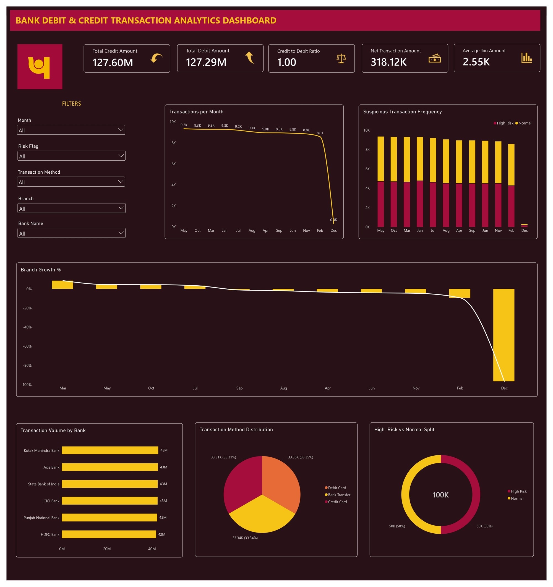
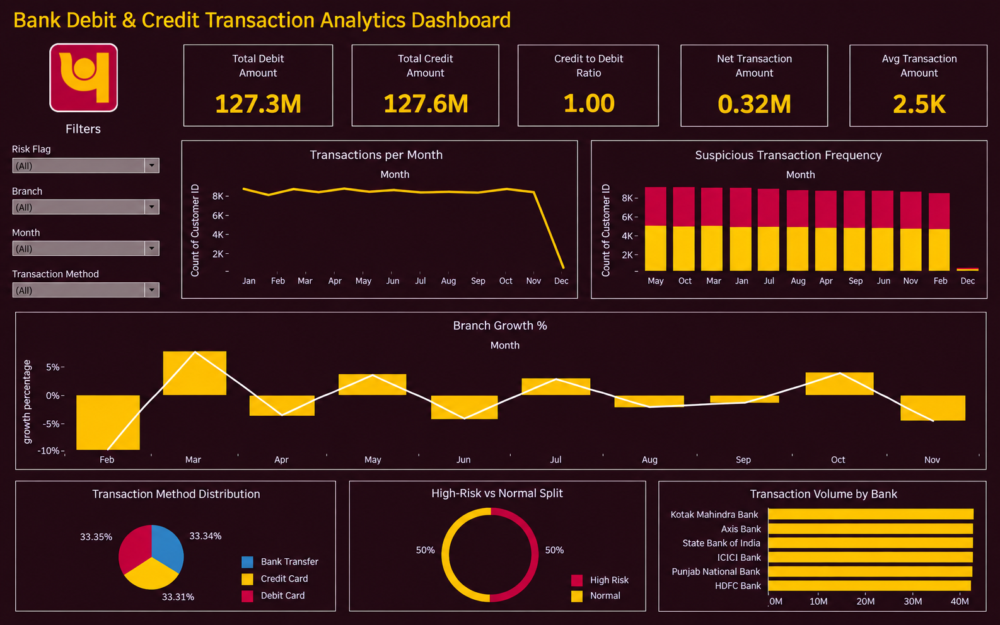
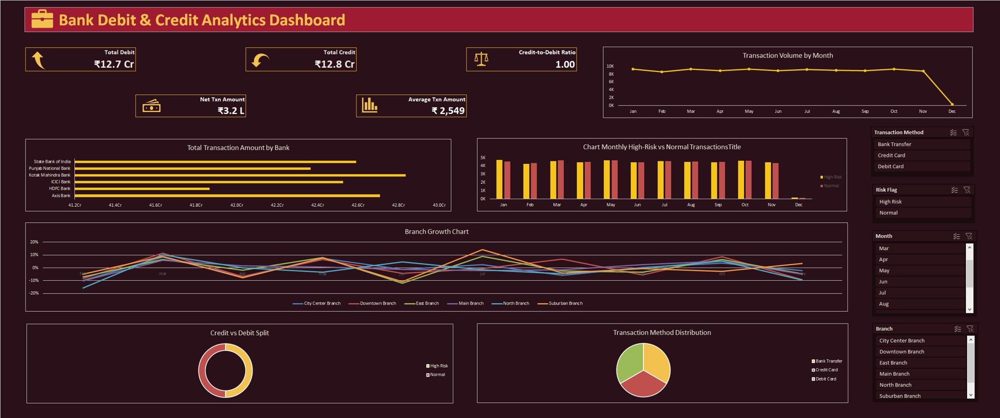

# Debit & Credit Transactions Analysis

Banking transaction analysis built with **Excel, MySQL, Power BI and Tableau**, from a banking analytics project completed during my Data Analyst internship at AiVariant (Jul–Oct 2026).

## Business questions
- How do debit and credit amounts compare, and how do transactions trend month to month?
- Which banks, branches and transaction methods drive volume, and where do high-risk transactions appear?

## Dataset
100,000 debit and credit transactions across six banks for 2024. Cleaning steps: fixed inconsistent headers, converted text dates to real dates, and labeled missing values instead of deleting rows. The raw data is not included in this repository.

## Tools
| Tool | Used for |
|---|---|
| Excel | Data cleaning, PivotTables, slicers and dashboard (screenshot below) |
| MySQL | Loaded the data and checked dashboard totals with SQL queries |
| Power BI | Interactive dashboard with DAX measures, KPI cards and slicers (screenshot below) |
| Tableau | Dashboard with calculated fields (screenshot below) |

## Dashboard (Power BI)


Slicers: month, risk flag, transaction method, branch and bank name.

## Dashboard (Tableau)


Filters: risk flag, branch, month and transaction method.

## Dashboard (Excel)


Built with PivotTables, slicers and charts.

## KPIs
| KPI | Value |
|---|---|
| Total debit amount | 127.3M |
| Total credit amount | 127.6M |
| Credit to debit ratio | 1.00 |
| Net transaction amount | 0.32M |
| Average transaction amount | 2.5K |

## Calculated measures
- **High-risk flag:** a transaction is flagged high risk when its amount is above the median transaction amount. Because the threshold is the median, about half of all transactions are flagged by design.
- **Month-over-month branch growth:** percentage change in transactions per month for each branch.

## Key findings
- Debit and credit are almost perfectly balanced (127.3M vs 127.6M, net 0.32M), so money in and money out were nearly equal over the year.
- Monthly transaction volume stays steady at roughly 8–9K from January to November.
- December shows a sharp drop because the data for that month is incomplete, so it should not be read as a real decline. This is a data limitation, not a business trend.
- Volume is spread almost evenly across the six banks and across the three transaction methods (about one third each).
- Month-over-month branch growth swings between roughly −10% and +8%.

## Validation
Totals were cross-checked so Excel, Power BI and Tableau report the same figures, and dashboard numbers were checked against SQL queries (see `transaction_qa_queries.sql`), with the expected result written next to each query.

## Repository structure
```
debit-credit-transactions-analysis/
├── README.md
├── transaction_qa_queries.sql
├── powerbi-dashboard.jpeg
├── tableau-dashboard.png
└── excel-dashboard.jpg
```
